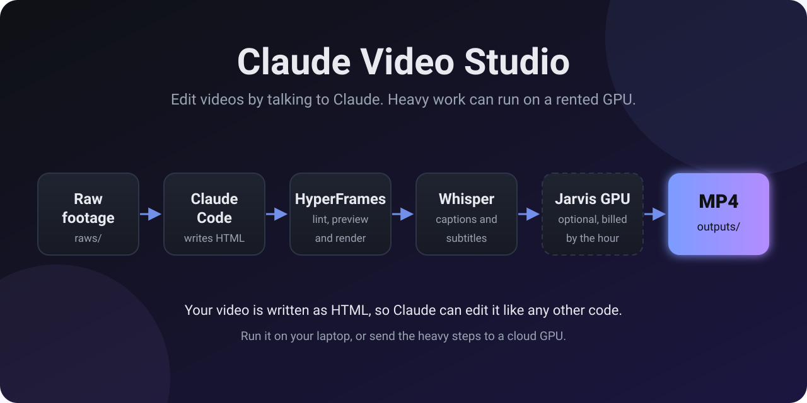

# Claude Video Studio

**Language / மொழி:** [English](#english) · [Tanglish](#tanglish) · [தமிழ்](#தமிழ்)



---

## English

Edit and render videos by talking to Claude Code. Heavy work (Whisper transcription and HyperFrames rendering) can run on a rented GPU from [Jarvis Labs](https://jarvislabs.ai), so you don't need a powerful laptop.

- **Editing engine:** [HyperFrames](https://github.com/heygen-com/hyperframes) (HeyGen, open source, Apache 2.0). You describe a video; Claude writes HTML/CSS/GSAP compositions; HyperFrames renders MP4.
- **Transcription:** `faster-whisper` with the `large-v3-turbo` model, for captions and subtitles.
- **Cloud bridge:** Jarvis Labs CLI (`jl`), linked to Claude Code through its agent skill.

Setup guide page: `index.html` (publish it with GitHub Pages).

### Quick start (local)

```bash
git clone https://github.com/unstopablethinkerr/claude-video-studio.git
cd claude-video-studio
bash scripts/setup-local.sh
claude            # open Claude Code in this folder
```

Inside Claude Code, ask for a video, for example:

> Create a 20-second product teaser in projects/teaser-1 using raws/clip1.mp4. Add captions from the transcript and render to outputs/teaser-1.mp4.

### Folder layout

| Folder | Purpose | In git? |
|---|---|---|
| `raws/` | Original footage and audio. Large. | No (ignored) |
| `projects/<name>/` | One HyperFrames composition per video | Yes |
| `outputs/` | Rendered MP4s and SRT files | No (ignored) |
| `scripts/` | Setup, upload, transcription, and cloud render scripts | Yes |
| `docs/` | Analysis and notes | Yes |

### Cloud workflow (for low-spec machines)

1. Create a Jarvis Labs account, add credit, and create an API key.
2. `jl setup` and paste the key. This also installs the Jarvis skill for Claude Code.
3. Create an instance: `jl create --gpu <GPU> --storage 100 --name video-studio`. Check GPUs and prices first with `jl gpus`.
4. Run the bulk job: `bash scripts/cloud-render.sh <machine_id>`. It uploads `raws/` and `projects/`, installs Node 22, ffmpeg, Chrome, and Whisper on the instance, transcribes everything, renders every project, and downloads `outputs/`.
5. Pause or destroy the instance when done. See the billing notes in `docs/ANALYSIS.md`.

### Test the setup

```bash
npx --yes hyperframes@0.9.19 lint projects/starter    # should report 0 errors
npx --yes hyperframes@0.9.19 render projects/starter -o outputs/starter.mp4
```

Rendering needs a browser. If it says "Chrome not found", run `npx --yes hyperframes@0.9.19 browser ensure`, or install Google Chrome and set `HYPERFRAMES_BROWSER_PATH`.

### Using an instance you created by hand

You can create an instance in the Jarvis dashboard (or with `jl create`), start it, and ask Claude Code to continue on it later as a fallback.

1. Run `python3 scripts/find-instance.py` to see your instances and their machine IDs.
2. Copy `jobs/job.example.json` to `jobs/job.json` and set `"machine_id"` to that ID.
3. Run `python3 scripts/check-budget.py jobs/job.json`, then confirm in Claude Code.

Claude will not create a second instance while you have one you want to use. If the instance is paused, resuming it starts billing again.

### Budget and cloud costs (read this first)

Jarvis Labs bills from your prepaid wallet. A GPU running for an hour costs that hour, even if it sits idle. A paused instance still bills storage, and a forgotten instance keeps running.

Before any cloud job:
1. Copy `jobs/job.example.json` to `jobs/job.json` and fill it in, or use the job form on the setup guide page.
2. Run `python3 scripts/check-budget.py jobs/job.json`. It reads your balance and GPU price, and blocks the job if the balance is too low or the hour cap is exceeded.
3. Confirm in the Claude Code chat before anything is created. Claude will pause the instance when the job finishes.

The CLI does not enforce a spending limit on your account. Check `jl list` and your Jarvis dashboard, and pause or destroy instances yourself if a session ends early. `jl destroy` deletes data.

### Something broke?

Run `bash scripts/collect-debug.sh`. It creates `debug-report.zip` with versions and diagnostics, with tokens redacted. Share that zip. Test results and known limits are in `docs/TESTING.md`.

### Secrets

Never commit API keys. `.env` is ignored. Copy `.env.example` to `.env` if you use `JL_API_KEY` directly.

---

## Tanglish

### Idhu enna repo?

Claude code kita chat paniye neenga easy ah video edit panalam. Video-va describe pannunga, Claude HTML-la edit pannum, HyperFrames render pannum, last-la MP4 kidaikkum.

Unga system low spec-la iruntha, neraya frames and heavy editing handle panradhu kastam. Adhanaala online rental GPU use pannalam. Video-va secure ah upload pannunga, edit pannunga, complete ah download pannunga, apram cloud-la iruka files-a clear pannunga. Periya powerful system use panradhukku idhu easy method.

- **Editing engine:** [HyperFrames](https://github.com/heygen-com/hyperframes) (HeyGen, open source, Apache 2.0). Neenga video-va describe pannunga, Claude HTML/CSS/GSAP la compositions ezhudhum, HyperFrames adha MP4 aaga render pannum.
- **Transcription:** `faster-whisper` (`large-v3-turbo` model). Captions and subtitles-ku use aagum.
- **Cloud bridge:** Jarvis Labs CLI (`jl`). Claude Code-oda Jarvis skill moolama connect aagum.

Setup guide page: `index.html` (GitHub Pages-la publish pannunga).

### Vegama aarambikkiradhu (local)

```bash
git clone https://github.com/unstopablethinkerr/claude-video-studio.git
cd claude-video-studio
bash scripts/setup-local.sh
claude            # indha folder-la Claude Code open aagum
```

Claude Code-kulla ippadi kelunga:

> projects/teaser-1 la raws/clip1.mp4 use panni 20 second product teaser pannu. Transcript la irundhu captions serthu, outputs/teaser-1.mp4 aaga render pannu.

### Folder amaippu

| Folder | Enna irukku | Git-la irukka? |
|---|---|---|
| `raws/` | Original footage and audio. Romba periya. | Illa (ignored) |
| `projects/<name>/` | Oru video-ku oru HyperFrames composition | Aama |
| `outputs/` | Render aana MP4 and SRT files | Illa (ignored) |
| `scripts/` | Setup, upload, transcribe, cloud render scripts | Aama |
| `docs/` | Analysis and notes | Aama |

### Cloud la edit panradhu (low spec system-ku)

1. Jarvis Labs la account open panni, credit serthu API key create pannunga.
2. `jl setup` run panni key paste pannunga. Idhu Claude Code-kku Jarvis skill-um install pannum.
3. Instance create pannunga: `jl create --gpu <GPU> --storage 100 --name video-studio`. Mudhala `jl gpus` la GPU and price paarunga.
4. Bulk job run pannunga: `bash scripts/cloud-render.sh <machine_id>`. Idhu footage and projects upload pannum, instance-la tools install pannum, transcribe pannum, every project-aiyum render pannum, apram `outputs/` download pannum.
5. Work mudinjudhum instance-a pause pannunga. Billing pathi `docs/ANALYSIS.md` paarunga.
6. Cloud la irukka files-um clear pannanum na `jl destroy` use pannunga. Ithu data-va delete pannidum, so download mudinjadhuku apram mattum pannunga.

### Setup sodhikka

```bash
npx --yes hyperframes@0.9.19 lint projects/starter    # 0 errors varanum
npx --yes hyperframes@0.9.19 render projects/starter -o outputs/starter.mp4
```

Render-ku browser venum. "Chrome not found" nu vandha `npx --yes hyperframes@0.9.19 browser ensure` run pannunga, illana Google Chrome install panni `HYPERFRAMES_BROWSER_PATH` set pannunga.

### Neenga create panna instance use panradhu

Jarvis dashboard la (illana `jl create` moolama) instance create panni start pannunga. Apram Claude Code-a andha instance-la continue panna sollalaam.

1. Ungal instances and machine IDs paarkka `python3 scripts/find-instance.py` run pannunga.
2. `jobs/job.example.json` a `jobs/job.json` aaga copy panni, `"machine_id"` la andha ID-a podunga.
3. `python3 scripts/check-budget.py jobs/job.json` run panni, Claude Code la confirm pannunga.

Neenga use panna virumbura instance irundha, Claude innoru instance create panna maatta. Paused instance-a resume pannina billing thirumba start aagum.

### Budget and cloud selavu (mudhala padinga)

Jarvis Labs unga prepaid wallet-la irundhu panam edukkum. GPU oru mani neram odinaa, summa iruntha kooda andha mani neratha kattanam. Paused instance-kum storage kattanam undu. Marandhu vitta instance thodarndhu odum.

Cloud job-ku mun:
1. `jobs/job.example.json` a `jobs/job.json` aaga copy panni fill pannunga, illana setup guide page la irukka job form use pannunga.
2. `python3 scripts/check-budget.py jobs/job.json` run pannunga. Idhu balance and GPU price paathu, balance kammiya irundha illa hour cap thaandinaa job-a block pannum.
3. Edhum create panradhuku mun Claude Code chat la confirm pannunga. Job mudinjadhum Claude instance-a pause pannum.

CLI unga account-ku spending limit podaadhu. `jl list` and Jarvis dashboard paarthu, session early-a mudinjaa instances-a neenga pause illana destroy pannunga. `jl destroy` data-va delete pannidum.

### Edhaavadhu problem aanaa

`bash scripts/collect-debug.sh` run pannunga. Idhu `debug-report.zip` create pannum, tokens hide aagirukkum. Andha zip-a share pannunga. Test results and known limits `docs/TESTING.md` la irukku.

### Secrets

API keys-a neenga kanakkula commit panradhu venaam. `.env` ignored. `JL_API_KEY` direct-aa use panradhaa irundha `.env.example` a `.env` aaga copy pannunga.

---

## தமிழ்

### இது என்ன repo?

Claude code கிட்ட chat பண்ணியே easy-ஆ video edit பண்ணலாம். Video-வ describe பண்ணுங்க, Claude HTML-ல edit பண்ணும், HyperFrames render பண்ணும், கடைசியா MP4 கிடைக்கும்.

உங்க system low spec-ஆ இருந்தா, நிறைய frames-உம் heavy editing-உம் handle பண்றது கஷ்டம். அதனால online rental GPU use பண்ணலாம். Video-வ secure-ஆ upload பண்ணுங்க, edit பண்ணுங்க, complete-ஆ download பண்ணுங்க, அப்புறம் cloud-ல இருக்குற files-அ clear பண்ணுங்க. பெரிய powerful system use பண்ணாமலே இது easy method.

- **Editing engine:** [HyperFrames](https://github.com/heygen-com/hyperframes) (HeyGen, open source, Apache 2.0). நீங்க video-வ describe பண்ணுங்க, Claude HTML/CSS/GSAP-ல compositions எழுதும், HyperFrames அத MP4-ஆ render பண்ணும்.
- **Transcription:** `faster-whisper` (`large-v3-turbo` model). Captions, subtitles-க்கு use ஆகும்.
- **Cloud bridge:** Jarvis Labs CLI (`jl`). Claude Code-ஓட Jarvis skill மூலமா connect ஆகும்.

Setup guide page: `index.html` (GitHub Pages-ல publish பண்ணுங்க).

### Quick start (local)

```bash
git clone https://github.com/unstopablethinkerr/claude-video-studio.git
cd claude-video-studio
bash scripts/setup-local.sh
claude            # இந்த folder-ல Claude Code open ஆகும்
```

Claude Code-குள்ள இப்படி கேளுங்க:

> projects/teaser-1-ல raws/clip1.mp4 use பண்ணி 20 second product teaser பண்ணு. Transcript-ல இருந்து captions சேர்த்து, outputs/teaser-1.mp4-ஆ render பண்ணு.

### Folder layout

| Folder | என்ன இருக்கு | Git-ல இருக்கா? |
|---|---|---|
| `raws/` | Original footage, audio. ரொம்ப பெரிசு. | இல்ல (ignored) |
| `projects/<name>/` | ஒரு video-க்கு ஒரு HyperFrames composition | ஆமா |
| `outputs/` | Render ஆன MP4, SRT files | இல்ல (ignored) |
| `scripts/` | Setup, upload, transcribe, cloud render scripts | ஆமா |
| `docs/` | Analysis, notes | ஆமா |

### Cloud-ல edit பண்றது (low spec system-க்கு)

1. Jarvis Labs-ல account open பண்ணி, credit சேர்த்து, API key create பண்ணுங்க.
2. `jl setup` run பண்ணி key paste பண்ணுங்க. இது Claude Code-க்கு Jarvis skill-உம் install பண்ணும்.
3. Instance create பண்ணுங்க: `jl create --gpu <GPU> --storage 100 --name video-studio`. முதல்ல `jl gpus`-ல GPU-வையும் price-யும் பாருங்க.
4. Bulk job run பண்ணுங்க: `bash scripts/cloud-render.sh <machine_id>`. இது footage-உம் projects-உம் upload பண்ணும், instance-ல tools install பண்ணும், transcribe பண்ணும், ஒவ்வொரு project-உம் render பண்ணும், அப்புறம் `outputs/` download பண்ணும்.
5. Work முடிஞ்சதும் instance-அ pause பண்ணுங்க. Billing பத்தி `docs/ANALYSIS.md` பாருங்க.
6. Cloud-ல இருக்குற files-உம் clear பண்ணணும்னா `jl destroy` use பண்ணுங்க. இது data-வ delete பண்ணிடும், so download முடிஞ்சதுக்கு அப்புறம் மட்டும் பண்ணுங்க.

### Setup சரியா இருக்கான்னு check பண்ண

```bash
npx --yes hyperframes@0.9.19 lint projects/starter    # 0 errors வரணும்
npx --yes hyperframes@0.9.19 render projects/starter -o outputs/starter.mp4
```

Render-க்கு browser வேணும். "Chrome not found"ன்னு வந்தா `npx --yes hyperframes@0.9.19 browser ensure` run பண்ணுங்க. இல்லன்னா Google Chrome install பண்ணி `HYPERFRAMES_BROWSER_PATH` set பண்ணுங்க.

### நீங்களே create பண்ண instance use பண்றது

Jarvis dashboard-ல (இல்லன்னா `jl create` மூலமா) instance create பண்ணி start பண்ணுங்க. அப்புறம் Claude Code-அ அந்த instance-ல continue பண்ண சொல்லலாம்.

1. உங்க instances, machine IDs பார்க்க `python3 scripts/find-instance.py` run பண்ணுங்க.
2. `jobs/job.example.json`-அ `jobs/job.json`-ஆ copy பண்ணி, `"machine_id"`-ல அந்த ID-அ போடுங்க.
3. `python3 scripts/check-budget.py jobs/job.json` run பண்ணி, Claude Code-ல confirm பண்ணுங்க.

நீங்க use பண்ண நினைக்கிற instance இருந்தா, Claude இன்னொரு instance create பண்ணாது. Paused instance-அ resume பண்ணா billing மறுபடி start ஆகும்.

### Budget, cloud செலவு (முதல்ல படிங்க)

Jarvis Labs, நீங்க முன்கூட்டியே போட்ட wallet-லிருந்து பணம் எடுக்கும். GPU ஒரு மணி நேரம் ஓடிச்சுன்னா, சும்மா இருந்தாலும் அந்த மணி நேரத்துக்கு காசு போகும். Paused instance-க்கும் storage காசு போகும். மறந்துட்ட instance தொடர்ந்து ஓடிட்டே இருக்கும்.

Cloud job-க்கு முன்னாடி:
1. `jobs/job.example.json`-அ `jobs/job.json`-ஆ copy பண்ணி fill பண்ணுங்க, இல்லன்னா setup guide page-ல இருக்குற job form use பண்ணுங்க.
2. `python3 scripts/check-budget.py jobs/job.json` run பண்ணுங்க. இது balance, GPU price பார்த்து, balance கம்மியா இருந்தாலோ hour cap தாண்டினாலோ job-அ block பண்ணும்.
3. எதையும் create பண்றதுக்கு முன்னாடி Claude Code chat-ல confirm பண்ணுங்க. Job முடிஞ்சதும் Claude instance-அ pause பண்ணும்.

CLI, உங்க account-க்கு spending limit போடாது. `jl list`, Jarvis dashboard பார்த்து, session சீக்கிரம் முடிஞ்சா instances-அ நீங்களே pause இல்ல destroy பண்ணுங்க. `jl destroy` data-வ delete பண்ணிடும்.

### ஏதாவது problem ஆச்சுனா

`bash scripts/collect-debug.sh` run பண்ணுங்க. இது `debug-report.zip` create பண்ணும், tokens hide ஆகியிருக்கும். அந்த zip-அ share பண்ணுங்க. Test results, known limits `docs/TESTING.md`-ல இருக்கு.

### Secrets

API keys-அ commit பண்ணவே பண்ணாதீங்க. `.env` ignored. `JL_API_KEY` direct-ஆ use பண்ணா `.env.example`-அ `.env`-ஆ copy பண்ணுங்க.

---

## Maintainer

This repo is maintained by **Bala Santhosh**.
இந்த repo-வை maintain பண்றது **Bala Santhosh**.
Indha repo-va maintain panradhu **Bala Santhosh**.

- Instagram: [@unstopablethinker](https://instagram.com/unstopablethinker)
- LinkedIn: [linkedin.com/in/bala-santhoshb](https://www.linkedin.com/in/bala-santhoshb)

Found a bug or have a question? Open an issue on this repo, or message on Instagram or LinkedIn.
Bug இருந்தாலோ கேள்வி இருந்தாலோ, இந்த repo-ல issue open பண்ணுங்க, இல்லன்னா Instagram or LinkedIn-ல message பண்ணுங்க.
Bug irundhaalo kelvi irundhaalo, indha repo la issue open pannunga, illana Instagram or LinkedIn la message pannunga.
